# Heart Disease Risk Prediction: End-to-End MLOps

**Course:** Machine Learning Operations (MLOps) AIMLCZG523 - Assignment 01  
**Student:** `Siddharth Raj` | **ID:** `2025ae05706` (`2025ae05706@wilp.bits-pilani.ac.in`)  
**Code repository:** `https://github.com/siddharthraj040997-voodoo/mlops-assign`  
**Deployed API / access:** `http://localhost:8000/docs` (local Kubernetes LoadBalancer: `http://localhost/docs` or `http://127.0.0.1:8000/docs`)  
**Demo video:** `<link to recording>`

## 1. Summary

A binary classifier predicts the presence of heart disease from 13 clinical attributes of the UCI Cleveland dataset (303 patients). The project wraps the model in a reproducible MLOps workflow: scripted data acquisition, an sklearn pipeline that bundles preprocessing with the model, MLflow experiment tracking (32 runs), pytest tests, a GitHub Actions pipeline, a Docker image serving a FastAPI endpoint, Kubernetes deployment manifests, and Prometheus/Grafana monitoring.

| Item | Result |
|---|---|
| Selected model | Logistic Regression (C = 1), refit on all 303 patients for deployment |
| 5-fold CV ROC-AUC (train split) | 0.903 +/- 0.014 |
| Hold-out test (61 patients) | accuracy 0.885, precision 0.839, recall 0.929, ROC-AUC 0.966 |
| Automated tests | 26 pytest tests, flake8 clean |
| Serving latency (local, in-process) | about 10 ms per `/predict` request |

## 2. Setup and installation

```bash
git clone https://github.com/siddharthraj040997-voodoo/mlops-assign && cd heart-disease-mlops
python -m venv .venv && source .venv/bin/activate        # Python 3.12
pip install -r requirements.txt

python scripts/download_data.py        # raw UCI file -> data/raw, cleaned CSV -> data/heart_clean.csv
python -m src.eda                      # EDA figures -> reports/figures
python -m src.train                    # tune 3 models, log to MLflow, save models/heart_pipeline.joblib
pytest && flake8 .                     # tests + lint

mlflow ui --backend-store-uri sqlite:///mlflow.db      # http://127.0.0.1:5000
uvicorn api.app:app --port 8000                        # http://127.0.0.1:8000/docs
```

Docker and Kubernetes:

```bash
docker build -t heart-api:1.0.0 . && docker run -p 8000:8000 heart-api:1.0.0
bash scripts/smoke_test.sh                 # curl tests against the container
docker compose up --build                  # API + Prometheus (:9090) + Grafana (:3000)
bash scripts/deploy_k8s.sh                 # Minikube / Docker Desktop Kubernetes
```

`scripts/download_data.py` tries the UCI file URL, then the `ucimlrepo` package (dataset id 45), then a GitHub mirror of the identical file, and validates that the result has 303 rows and 14 columns.

## 3. Data and exploratory analysis

**Source.** UCI Heart Disease, Cleveland subset (`processed.cleveland.data`): 303 patients, 13 predictors and a target coded 0 to 4. The target is binarised (0 = no disease, 1-4 = disease).

**Cleaning.** Missing values are coded `?` in the raw file: 4 in `ca` and 2 in `thal`. Duplicates were checked (none). Missing values are deliberately left as NaN in the cleaned CSV and imputed *inside* the sklearn pipeline, so that imputation statistics come from training folds only and never leak from validation data.

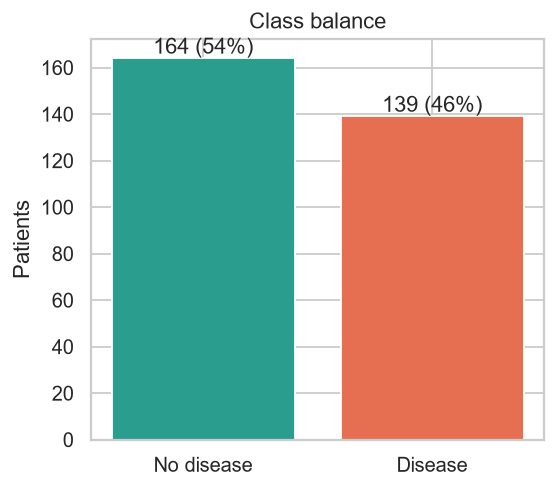{width=45%}

The classes are nearly balanced, so no resampling is needed and accuracy is meaningful. Recall is still tracked closely because a missed case is the costly error in a screening setting.

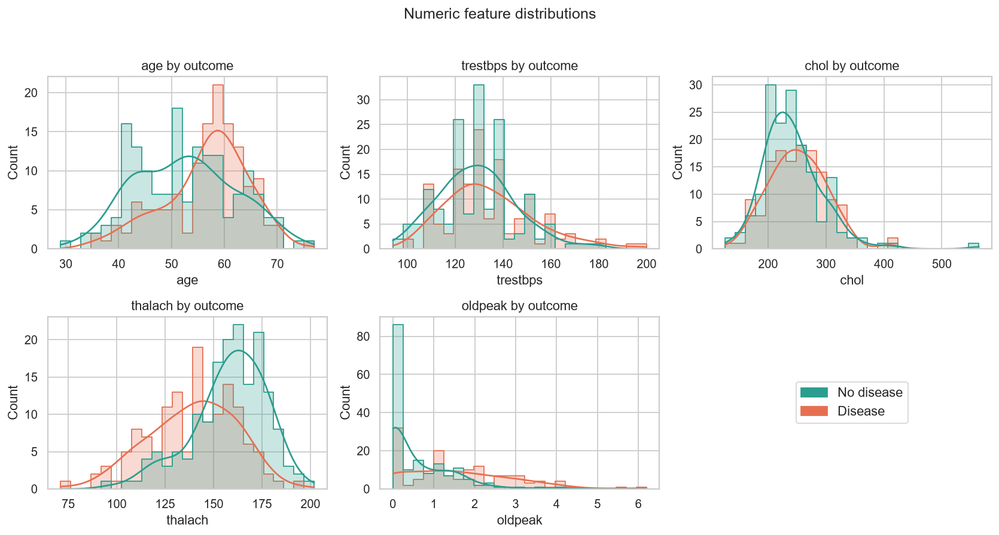{width=92%}

Patients with disease have lower peak heart rate (`thalach`), higher ST depression (`oldpeak`) and skew older. Cholesterol and resting blood pressure overlap heavily between the groups, so they are weak predictors on their own.

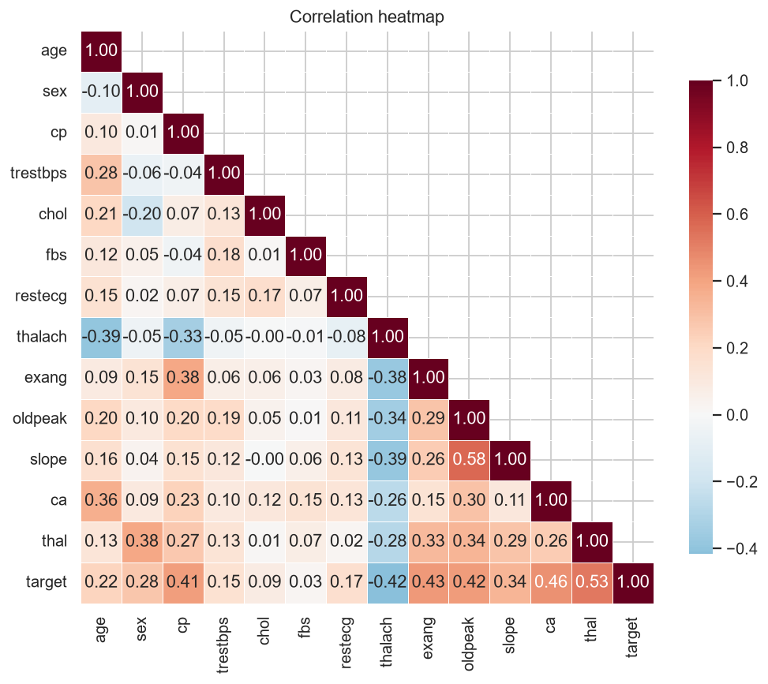{width=70%}

The strongest linear associations with the target are `thal` (0.53), `ca` (0.46), `exang` (0.43), `oldpeak` (0.42), `thalach` (-0.42) and `cp` (0.41). No pair of predictors is so strongly collinear (|r| > 0.8) that it would destabilise the logistic regression.

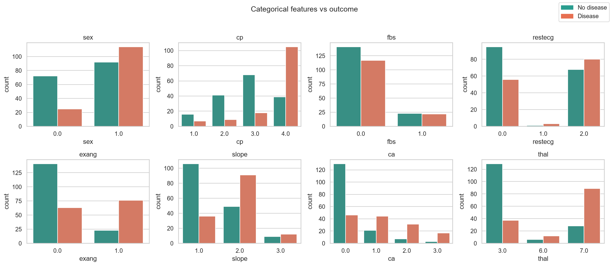{width=92%}

Asymptomatic chest pain (`cp` = 4), reversible thalassemia defect (`thal` = 7), exercise angina and zero fluoroscopy vessels (`ca` = 0, protective) separate the classes clearly. Boxplots (`reports/figures/boxplots.png`) show a few high-cholesterol outliers (up to 564 mg/dl). They were kept, since they are clinically plausible and the scaler/regularised model tolerates them.

## 4. Feature engineering and modelling

### 4.1 Pipeline

Every model is a single sklearn `Pipeline`, so training and serving apply identical transformations:

| Step | What it does |
|---|---|
| `FeatureEngineer` | Adds `hr_ratio = thalach / (220 - age)`, the fraction of age-predicted maximum heart rate reached |
| `ColumnTransformer` / numeric | median imputation, then `StandardScaler` (age, trestbps, chol, thalach, oldpeak, hr_ratio) |
| `ColumnTransformer` / categorical | most-frequent imputation, then one-hot with `handle_unknown="ignore"` (sex, cp, fbs, restecg, exang, slope, ca, thal) |
| Classifier | Logistic Regression, Random Forest or Gradient Boosting |

Coded features such as `cp`, `slope` and `thal` have no meaningful numeric ordering (e.g. `thal` = 3, 6, 7), so they are one-hot encoded rather than scaled.

### 4.2 Model selection and tuning

The data was split 80/20 (stratified, seed 42) into 242 training and 61 test patients. Each model was tuned with `GridSearchCV` over 5-fold stratified cross-validation on the training split, scoring ROC-AUC (accuracy, precision and recall are also recorded). The test split was used only to report final metrics, never to choose a model.

| Model | Grid searched | Best parameters |
|---|---|---|
| Logistic Regression | C in {0.01, 0.1, 1, 10} x class_weight in {None, balanced} (8) | C = 1, class_weight = None |
| Random Forest | n_estimators {200, 400} x max_depth {3, 5, None} x min_samples_leaf {1, 3} (12) | 400 trees, depth 3, leaf 3 |
| Gradient Boosting | n_estimators {100, 200} x learning_rate {0.05, 0.1} x max_depth {2, 3} (8) | 100 trees, lr 0.05, depth 2 |

| Model | CV ROC-AUC | CV acc. | CV prec. | CV recall | Test ROC-AUC | Test acc. | Test prec. | Test recall |
|---|---|---|---|---|---|---|---|---|
| **Logistic Regression** | **0.903** +/- 0.014 | 0.847 | 0.877 | 0.783 | 0.966 | 0.885 | 0.839 | 0.929 |
| Random Forest | 0.902 +/- 0.025 | 0.818 | 0.843 | 0.755 | 0.957 | 0.836 | 0.800 | 0.857 |
| Gradient Boosting | 0.878 +/- 0.028 | 0.822 | 0.829 | 0.783 | 0.959 | 0.902 | 0.867 | 0.929 |

**Choice.** Logistic Regression and Random Forest are statistically tied on CV ROC-AUC (0.9025 vs 0.9020). Logistic Regression was selected because it has the lowest fold-to-fold variance, is directly interpretable (coefficients map to clinical factors), is the smallest and fastest to serve, and gave the best test ROC-AUC. The Gradient Boosting test accuracy (0.902) is higher but rests on 61 patients: one patient is worth 1.6 percentage points, so the three test accuracies are not meaningfully different. With only 303 rows, the honest conclusion is that all three models perform similarly.

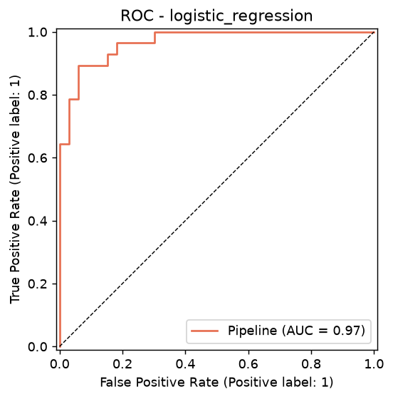{width=42%}
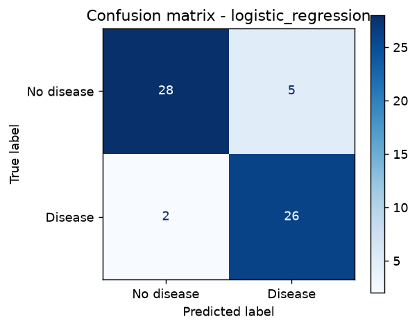{width=38%}

On the hold-out set the model produced 28 true negatives, 5 false positives, 2 false negatives and 26 true positives, so recall (0.929) exceeds precision (0.839): it errs towards flagging patients, the preferred direction for risk screening.

**Feature ablation.** The engineered `hr_ratio` was tested with 5x5 repeated CV: ROC-AUC 0.8983 with the feature versus 0.8985 without. The feature gives no measurable benefit. It is retained because it is domain-motivated and costs nothing, but the result is reported rather than presented as an improvement.

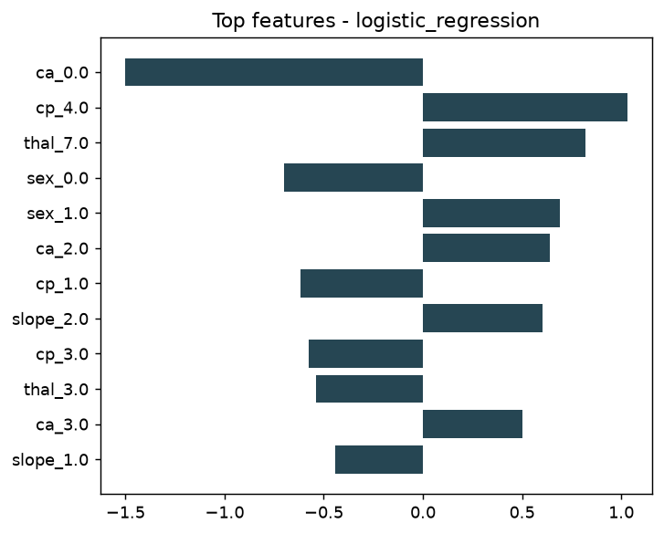{width=48%}

**Final model.** After selection, the winning configuration was refit on all 303 labelled patients and saved for deployment; the reported metrics above come from the earlier hold-out evaluation.

## 5. Experiment tracking (MLflow)

`src/train.py` writes to a SQLite-backed MLflow store (`mlflow.db`) with artifacts in `mlartifacts/`, experiment `heart-disease-risk`.

| Run type | Count | Logged |
|---|---|---|
| Model-selection parent run (one per model family) | 3 | params, CV and test metrics, ROC curve, confusion matrix, feature-importance plot, the fitted model with signature and input example |
| Nested tuning runs (one per grid candidate) | 28 | hyper-parameters, mean and std of CV ROC-AUC / accuracy / precision / recall |
| Final run | 1 | selected params, metrics, model registered as `heart-disease-classifier` v1, `metrics.json`, joblib artifact |

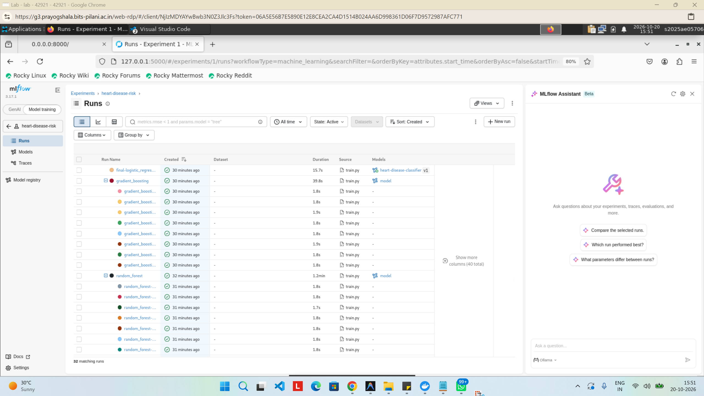{width=80%}

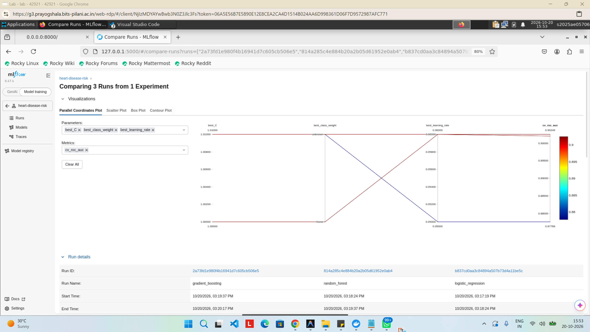{width=80%}

## 6. Model packaging and reproducibility

- **Artifact:** `models/heart_pipeline.joblib` holds the *whole* pipeline (feature engineering, imputers, scaler, encoder, classifier). Serving cannot drift from training because there is no separate preprocessing code to keep in sync. The same pipeline is also logged to MLflow in its native flavour and registered in the model registry.
- **Environments:** `requirements.txt` (full, pinned) and `requirements-api.txt` (minimal runtime, pinned). scikit-learn 1.8.0 is pinned identically for training and for the Docker image, since pickled estimators are not guaranteed to load across versions.
- **Determinism:** every random component uses seed 42; the split is stratified; the CV folds are seeded.
- **Clean-setup check:** `pip install -r requirements.txt` was verified in a fresh virtual environment.

## 7. Automated testing and CI/CD

### 7.1 Tests (`tests/`, 26 cases)

| File | Covers |
|---|---|
| `test_data.py` | target binarisation, `?` parsing, duplicate removal, NaNs preserved for the pipeline, X/y split |
| `test_preprocessing.py` | `hr_ratio` correctness, no input mutation, extreme-age safety, no NaNs after preprocessing, standardisation, unseen categories |
| `test_model.py` | probability shape and range, CV ROC-AUC above chance, missing-value handling, save/load determinism, deployed artifact loads |
| `test_api.py` | `/health`, `/predict` response contract, 422 on invalid fields (parametrised), missing field, metrics exposure, 503 when the model is missing |

The tests use a seeded synthetic dataset, so they run offline and do not depend on the real data or a trained model.

```text
$ flake8 . --count          ->  0
$ pytest                    ->  26 passed
```

### 7.2 GitHub Actions (`.github/workflows/ci.yml`)

Two jobs on every push and pull request:

1. **lint-test-train:** install from `requirements.txt`, `flake8` (fails on any violation), `pytest` with JUnit and coverage XML (fails on any failing test), download data, generate EDA figures, train and track, then verify the artifact loads and predicts. Uploaded artifacts: the model and metrics, `mlflow.db` and `mlartifacts/`, figures, the cleaned dataset, and `ci_logs/` (pytest, download and train logs, JUnit and coverage XML).
2. **docker** (needs job 1): download the freshly trained model, build the image, run the container, wait for `/health`, run `scripts/smoke_test.sh`, and upload the smoke-test and container logs.

Because the workflow sets `defaults.run.shell: bash` (which runs steps as `bash -eo pipefail`, so a failing command piped into `tee` still fails the step), any lint, test, training or smoke-test error fails the run and leaves the logs as downloadable artifacts.

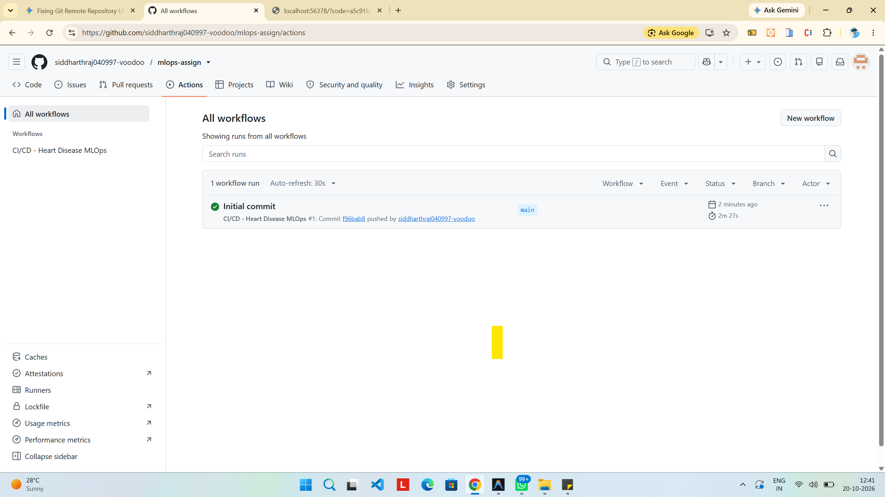{width=80%}

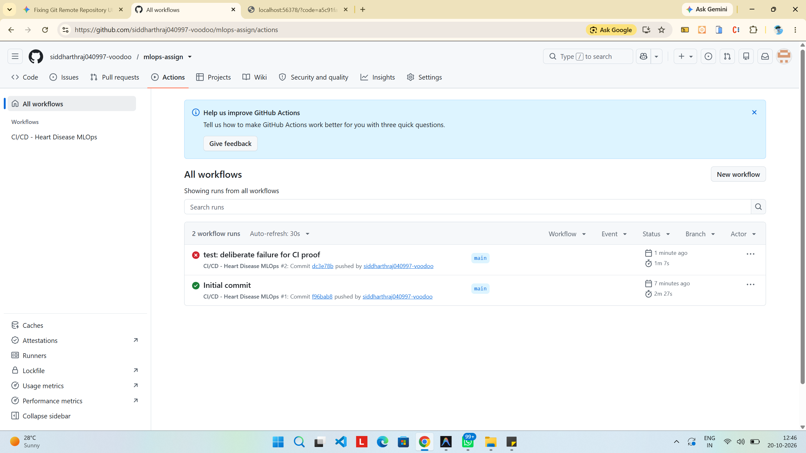{width=80%}

## 8. Containerisation

`Dockerfile`: `python:3.12-slim`, installs only `requirements-api.txt`, copies `src/`, `api/` and the model, runs as non-root user (uid 10001), exposes 8000, includes a `HEALTHCHECK` on `/health`, and starts `uvicorn`.

| Endpoint | Purpose |
|---|---|
| `POST /predict` | JSON with the 13 features, returns `prediction`, `label`, `confidence`, `probability_disease`, `model_version` |
| `GET /health` | readiness/liveness (503 if the model failed to load) |
| `GET /metrics` | Prometheus exposition |
| `GET /docs` | interactive OpenAPI documentation |

Inputs are validated by Pydantic (for example `age` 1-120, `cp` in {1,2,3,4}, `thal` in {3,6,7}); invalid requests receive HTTP 422 with the offending field. Sample request and response (captured from the running API):

```bash
curl -X POST http://localhost:8000/predict -H 'Content-Type: application/json' -d '{
  "age":63,"sex":1,"cp":1,"trestbps":145,"chol":233,"fbs":1,"restecg":2,
  "thalach":150,"exang":0,"oldpeak":2.3,"slope":3,"ca":0,"thal":6}'
```
```json
{"prediction":0,"label":"no_disease","confidence":0.8504,"probability_disease":0.1496,"model_version":"1.0.0"}
```

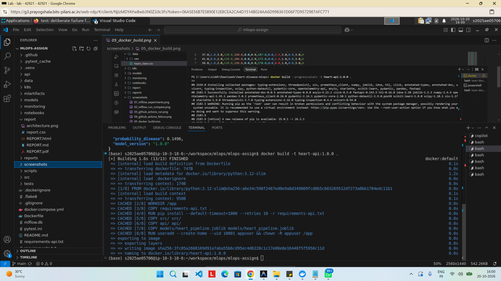{width=75%}

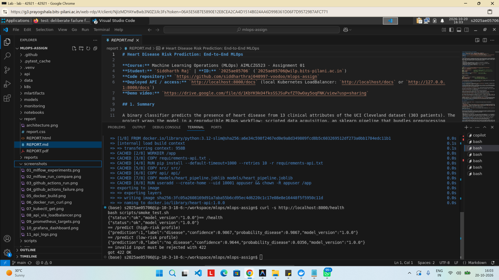{width=75%}

## 9. Kubernetes deployment

Manifests in `k8s/`: `namespace.yaml`, `deployment.yaml` (2 replicas, rolling update with zero unavailable, readiness/liveness probes on `/health`, CPU/memory requests and limits), `service.yaml` (type LoadBalancer), `hpa.yaml` (2-5 pods at 70% CPU) and an optional `ingress.yaml`. `scripts/deploy_k8s.sh` builds the image, loads it into Minikube if present, applies the manifests and waits for the rollout. On a managed cluster (GKE/EKS/AKS) the image is pushed to a registry and the `image:` field changed; the LoadBalancer then receives a public IP.

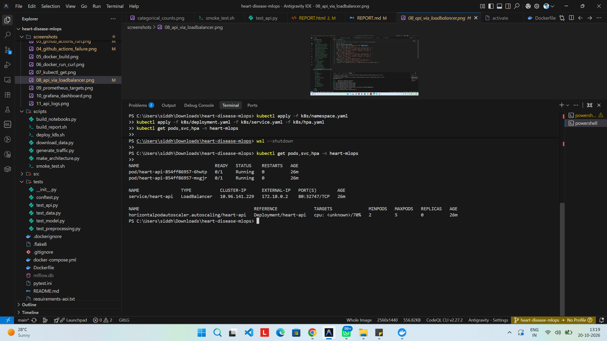{width=75%}

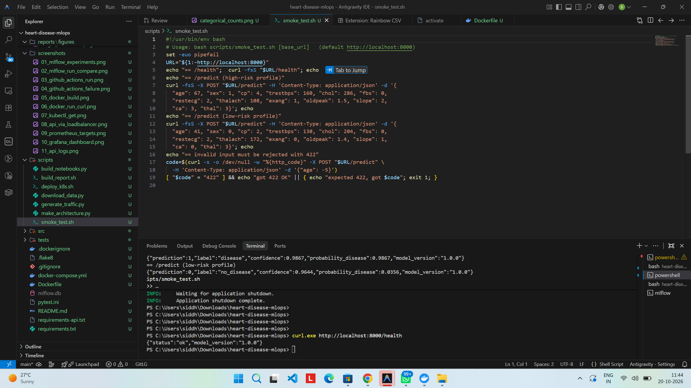{width=75%}

## 10. Monitoring and logging

**Logging.** Each request produces one structured JSON line (request id, method, path, status, latency in ms, client) and each prediction a second line (class, confidence, age). Lines go to stdout, so `docker logs` and `kubectl logs` work, and to `LOG_FILE` when that variable is set. A request id is returned in the `x-request-id` header.

**Metrics.** Exposed at `/metrics`:

| Metric | Type | Use |
|---|---|---|
| `heart_api_requests_total{method,path,status}` | counter | traffic and error rate |
| `heart_api_request_latency_seconds{path}` | histogram | p50/p95/p99 latency |
| `heart_api_predictions_total{label}` | counter | predicted-class mix (drift signal) |
| `heart_api_prediction_confidence` | histogram | confidence distribution |
| `heart_api_model_loaded` | gauge | model health |

Prometheus scrapes the API every 5 s (`monitoring/prometheus.yml` for Docker Compose, a pod-discovery config in `k8s/monitoring/monitoring.yaml` for Kubernetes). A provisioned Grafana dashboard (`monitoring/grafana/dashboards/heart_api.json`) shows request rate, latency percentiles, predictions by class, error rate, mean confidence, model status and total requests. `scripts/generate_traffic.py` replays real dataset rows (plus a few invalid requests) to populate it.

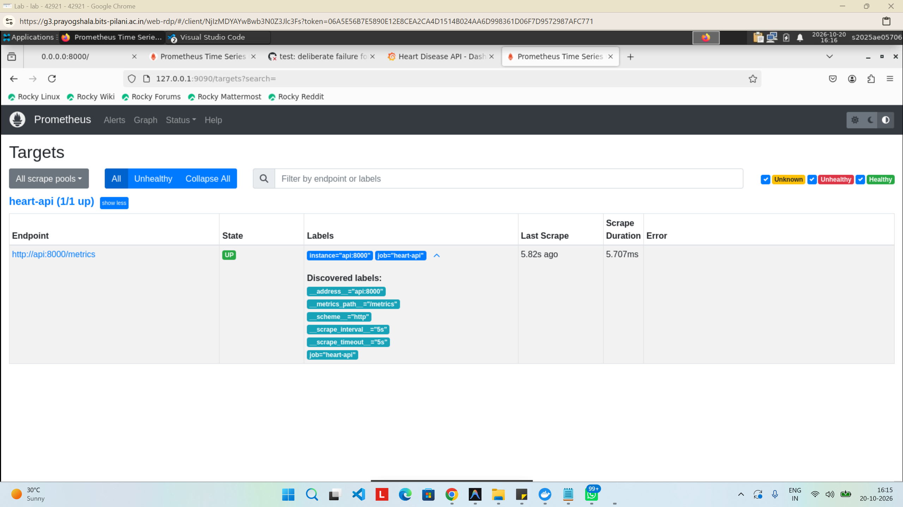{width=75%}

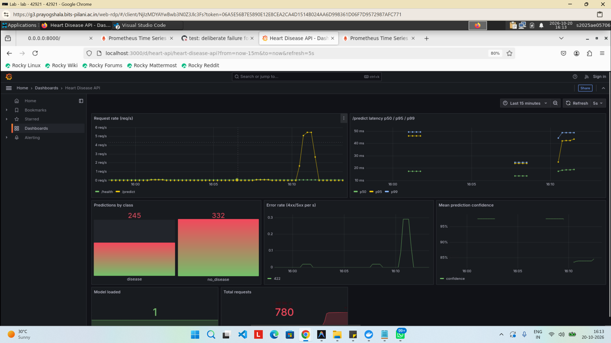{width=75%}

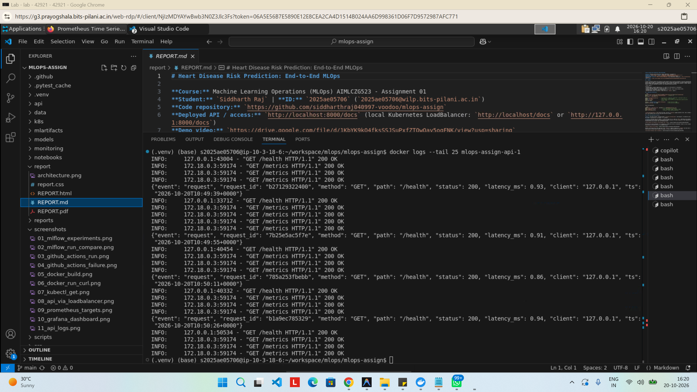{width=75%}

## 11. Architecture

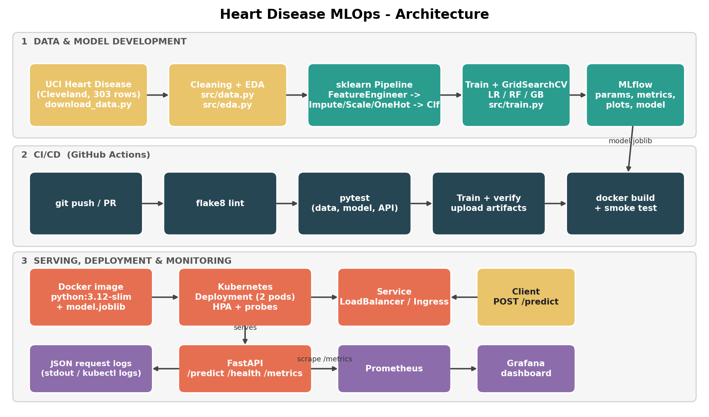{width=95%}

## 12. Limitations and future work

- **Small data.** 303 patients give wide uncertainty: a 61-patient test set means a single patient moves accuracy by 1.6 points, and CV standard deviations (0.014 to 0.028) are larger than the gaps between models. Results should not be over-interpreted.
- **Single hospital.** The Cleveland cohort may not generalise to other populations; the other three UCI sites could be used for external validation.
- **Not a medical device.** The API is a course demonstration and must not be used for clinical decisions.
- **Next steps:** probability calibration, a decision threshold chosen for a target recall, data-drift alerts on the input features (not only the prediction mix), automated image push and deploy on tagged releases, and model promotion through the MLflow registry stages.

## 13. Repository layout

```text
data/ (raw + heart_clean.csv)   scripts/ (download, deploy, smoke test, traffic)
src/ (config, data, preprocessing, eda, train)   api/app.py   tests/
notebooks/ (01_eda, 02_training, 03_inference)   models/ (pipeline + metrics.json)
k8s/ (+ monitoring/)   monitoring/ (prometheus, grafana)   .github/workflows/ci.yml
Dockerfile  docker-compose.yml  requirements.txt  requirements-api.txt
screenshots/   report/ (REPORT.md, REPORT.pdf, architecture.png)
```
